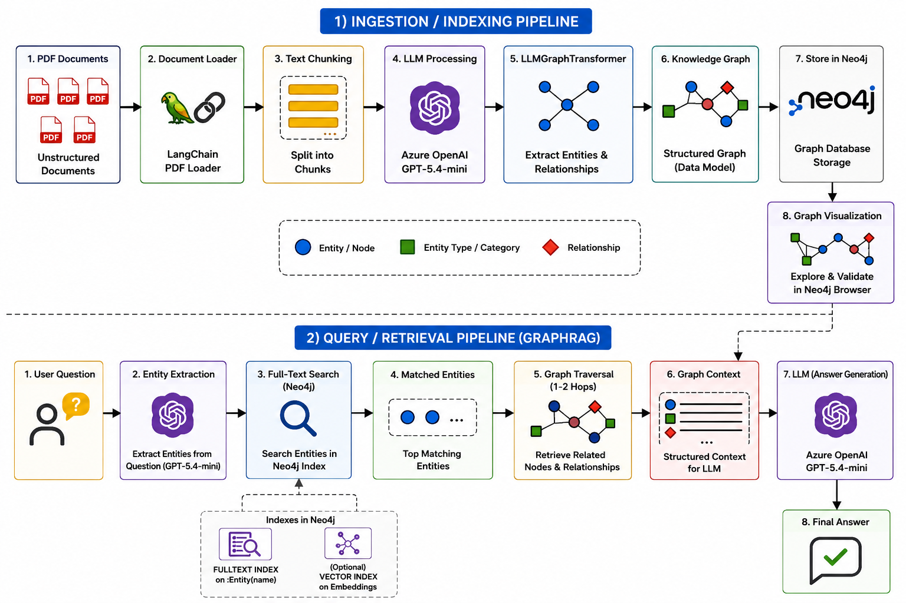

# GraphRAG with Neo4j, LangChain, and Azure OpenAI

An end-to-end, notebook-first GraphRAG example. It turns PDF text into a knowledge graph, stores that graph in Neo4j, and retrieves graph context to answer natural-language questions with Azure OpenAI.

**Docker Desktop runs Neo4j 5.26 as a local container.** The notebook connects from Python to Neo4j over the Bolt protocol. Neo4j stores the extracted entities and relationships; LangChain handles PDF loading, chunking, graph extraction, and retrieval; Azure OpenAI extracts query entities and writes answers from the retrieved graph context.

## How it works

```text
PDF documents → page-aware text extraction → overlapping chunks
             → LLM entity and relationship extraction → Neo4j knowledge graph
Question → LLM entity extraction → exact, partial, or full-text entity retrieval
         → connected graph context → Azure OpenAI answer
```

```text
Docker Desktop
└── neo4j-graphrag (neo4j:5.26)
    ├── Browser: http://localhost:7474
    ├── Python / LangChain → Bolt: bolt://localhost:7687
    └── Docker volume neo4j_data → persistent graph database files
```

The notebook compares three entity-retrieval strategies: exact matching, keyword-based partial matching, and a Neo4j full-text index. The comparison makes the core GraphRAG trade-offs visible, including query sensitivity, retrieval scope, and the value of structured graph context.

## Architecture



## Prerequisites

- Python 3.10 or newer
- Docker Desktop with the Linux container engine running
- An Azure OpenAI resource, a deployed chat model, and an API key
- The synthetic NexaTech demo PDF corpus included in `data/`

## Quick start on Windows

Open PowerShell in the project directory:

```powershell
py -3 -m venv .venv
.\.venv\Scripts\Activate.ps1
python -m pip install --upgrade pip
python -m pip install -r requirements.txt
Copy-Item .env.example .env
```

Edit `.env` locally. Set the Azure resource endpoint, API key, actual deployment name, and a unique Neo4j password. **Never put real credentials in the notebook, commit them, or paste them into issue reports.** If a key has ever been committed or shared, revoke it in Azure and create a replacement.

After Docker Desktop is running with its **Linux container engine** selected, start the Neo4j database container from this project directory:

```powershell
docker compose up -d
docker compose ps
```

Compose starts the same Neo4j image and container name used in the original setup: `neo4j:5.26` as `neo4j-graphrag`. It publishes Neo4j Browser and HTTP on port `7474` and its Bolt driver on port `7687`. The Compose health check waits for `cypher-shell` to authenticate successfully; confirm the service status with `docker compose ps`. Connect Neo4j Browser at [http://localhost:7474](http://localhost:7474) and Python/LangChain to `bolt://localhost:7687`, using the local `.env` credentials.

The equivalent original Docker command is `docker run -d --name neo4j-graphrag -p 7474:7474 -p 7687:7687 -e NEO4J_AUTH=neo4j/<your-password> -v neo4j_data:/data neo4j:5.26`. Use the Compose setup above for this repository so the APOC configuration, health check, credential template, and volume are documented together. Do not use a real password in shell history or commit it to the repository.

The `neo4j_data` named Docker volume stores Neo4j's database files, so recreating the container keeps the graph. `NEO4J_PLUGINS` enables the APOC plugin for the project's graph operations. Inspect the container output with `docker compose logs -f neo4j`. To stop the database, run `docker compose down`; it retains the graph volume. To remove the local database and its graph data, run `docker compose down --volumes`.

Once Neo4j reports `healthy`, start the notebook:

```powershell
python -m jupyter lab GraphRAG.ipynb
```

Run the notebook cells in order. Azure model deployment names belong to your own Azure account; update `AZURE_OPENAI_DEPLOYMENT` to a deployment that exists in your resource. LLM calls are billable and send the text of the documents you choose to index to your Azure OpenAI resource.

## Data and privacy

The included PDFs form a fictional, synthetic NexaTech Solutions demo corpus provided with this project. Names, people, organizations, employment policies, clients, and projects in these examples are illustrative; do not treat them as verified real-world facts. LLM calls send source document text to your configured Azure OpenAI deployment, so use the included synthetic corpus for this public demo. Do not add real personal or confidential business data without permission to disclose it and process it with that service. Notebook outputs have been cleared from the committed notebook to keep sample records out of saved execution results.

Processing documents with a language model sends their text to the configured Azure OpenAI deployment. Use only content you have permission to send to that service. Keep `.env` local; it is excluded by `.gitignore`.

## Repository layout

```text
.
├── GraphRAG.ipynb       # annotated end-to-end GraphRAG walkthrough
├── compose.yaml         # local Neo4j and APOC setup
├── .env.example         # safe configuration template
├── requirements.txt     # Python dependencies
├── images/              # explanatory architecture and search diagrams
└── data/                # synthetic NexaTech demo PDF source documents
```

## Known limitations and next steps

- Graph extraction quality depends on the configured model and document chunking; review extracted entities and relationships before relying on them.
- The notebook is a teaching/demo workflow rather than a production service. It does not provide authentication for public users, ingestion scheduling, access controls, or evaluation and monitoring.
- The included retrieval strategies focus on names and graph traversal. Hybrid vector retrieval, source citations, entity resolution, and a question evaluation set would be useful next steps.

## License

Add a license file before accepting contributions or indicating reuse terms. No license is currently declared.
